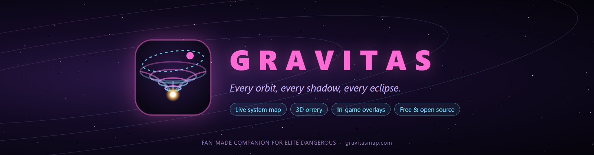
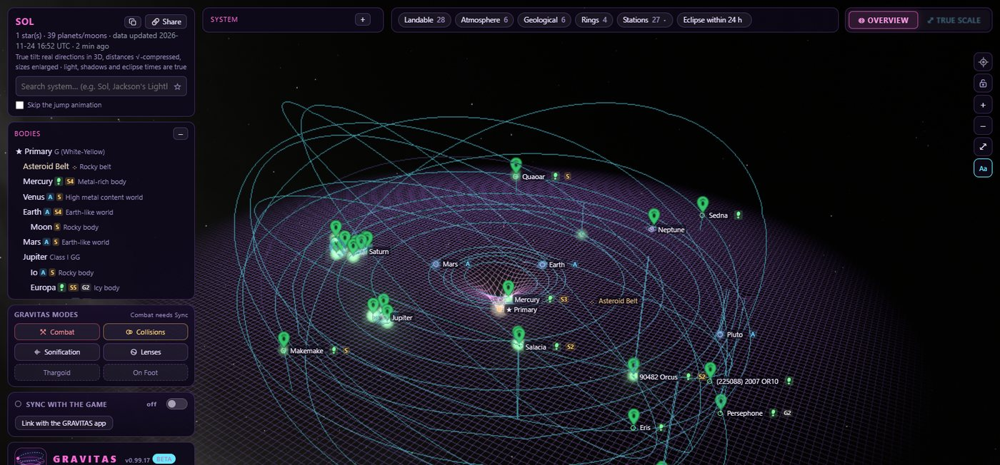
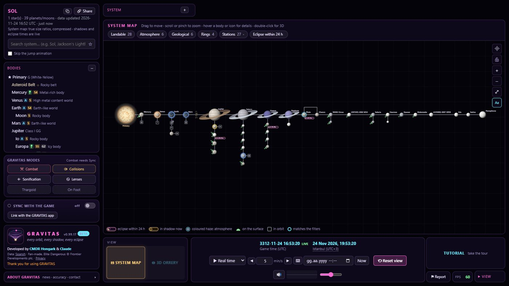
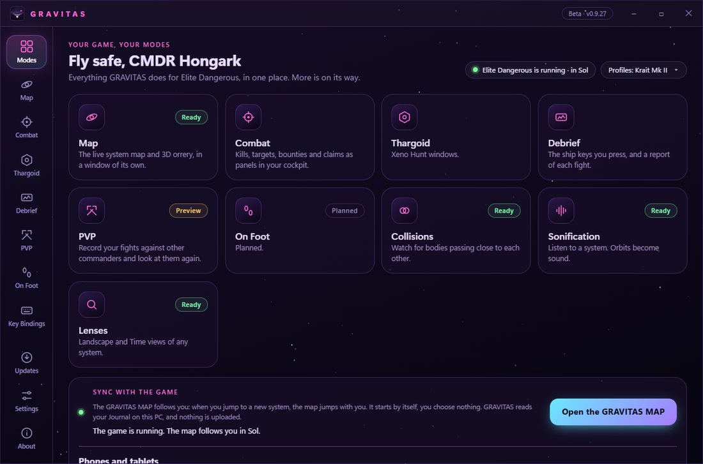
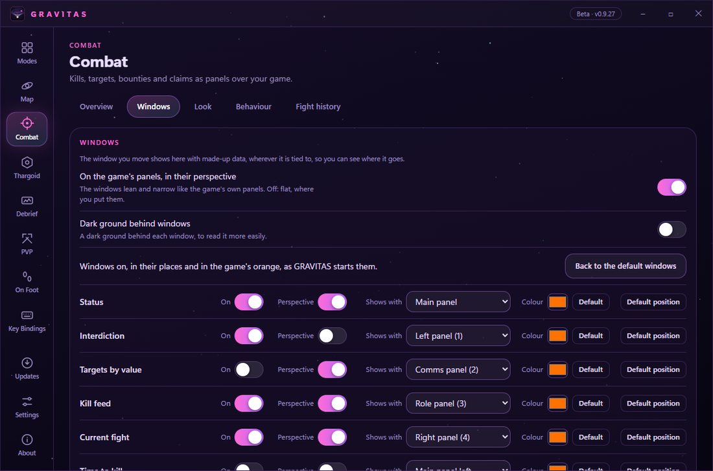
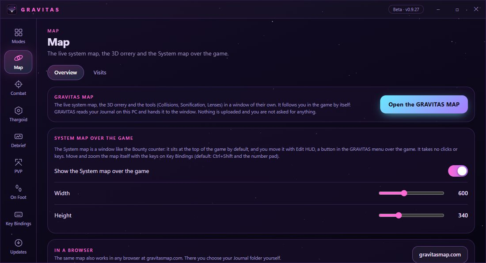
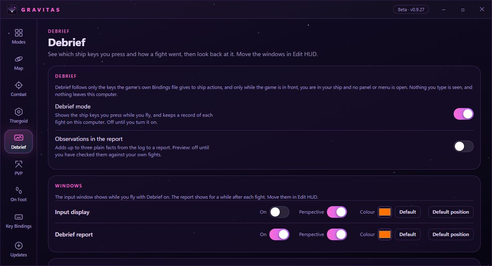
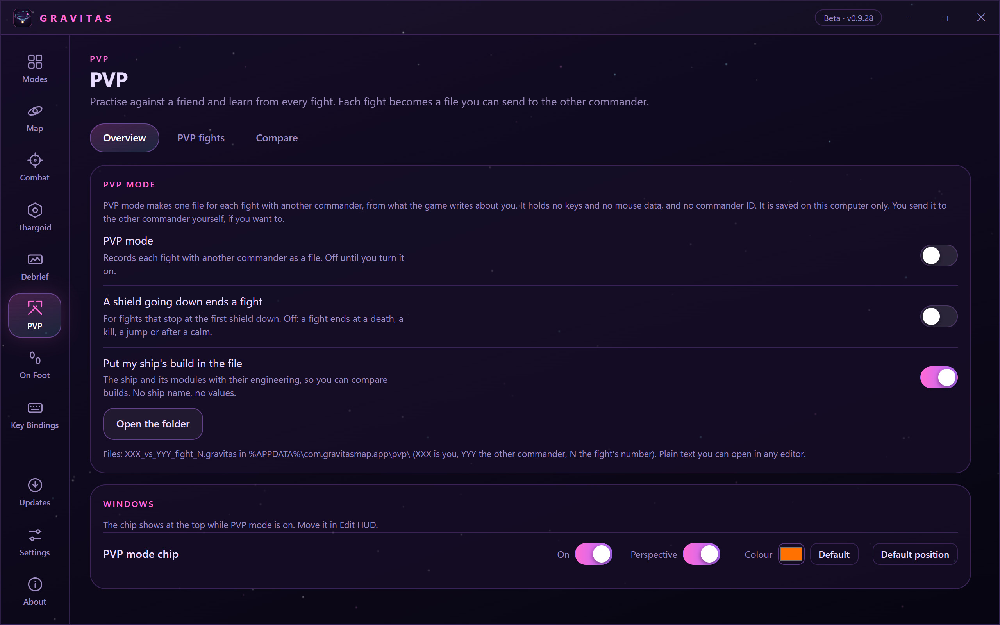
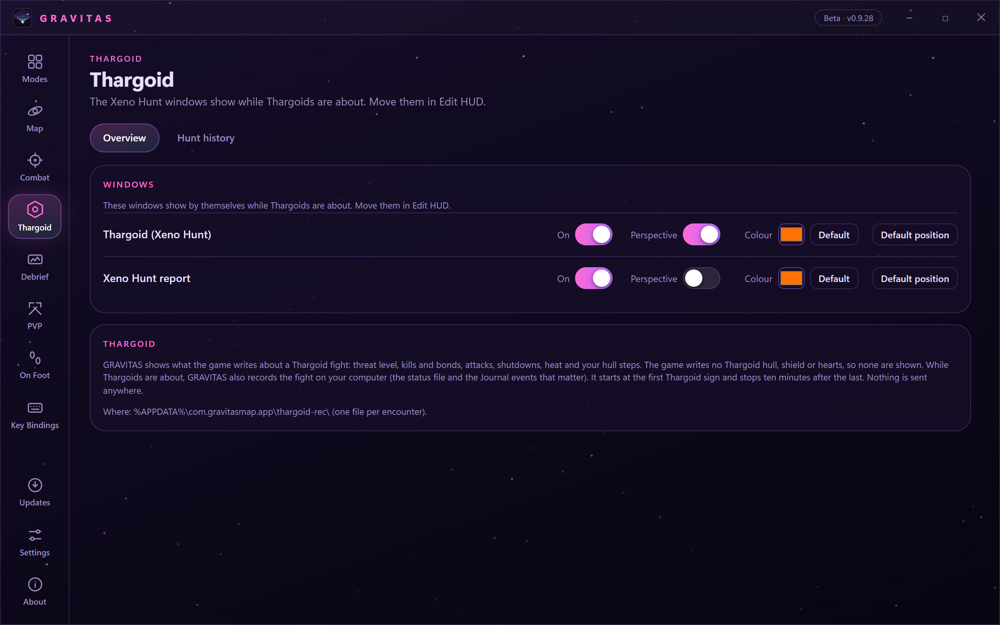
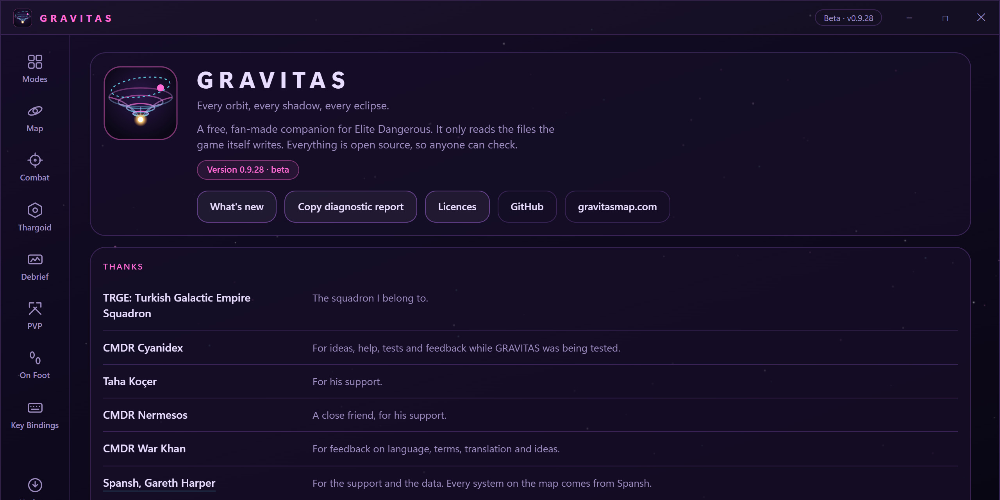

<div align="center">



### A live system map, an orrery and in-game overlays for Elite Dangerous

Free, open source and fan-made. No accounts, no ads, no tracking.

[](https://gravitasmap.com)
[](LICENSE)
[](docs/app.md)
[](#licence-and-disclaimer)
[](PRIVACY.md)

**[Website](https://gravitasmap.com)** ·
**[Download the app](https://gravitasmap.com)** ·
**Microsoft Store: coming soon** ·
**[Docs](docs/README.md)** ·
**[Privacy](PRIVACY.md)** ·
**[Changelog](CHANGELOG.md)**

</div>

---

## What is GRAVITAS

GRAVITAS has two parts that work together.

- **The website, [gravitasmap.com](https://gravitasmap.com).** Open any system and see it move: planets, moons, rings, stations, shadows and eclipses, at the real time of the game. It runs in any modern browser.
- **The GRAVITAS app for Windows.** It follows your game by reading the Journal files the game itself writes, shows the map in a window of its own, and draws small click-through panels (a bounty counter, a kill feed, a report and more) over the game.

The old EDMC plugin is retired and replaced by this app. Everything it knows comes from the game's own files and from public data ([Spansh](https://spansh.co.uk)). It does not read the game's memory and does not change the game.

<p align="center">
  
</p>

## What it does

| | |
|---|---|
| **Map and orrery** | The live System map and a 3D orrery of any system, with true orbits, shadows, an eclipse calendar and a Sky view. The default view is a readable overview, and *True scale* is one click away. |
| **Sync with the game** | The map follows you: jump to a new system and it jumps with you. In the app this needs no folder question. In a browser you choose your Journal folder once, read-only. |
| **Combat, Thargoid, Debrief, PVP** | Panels over your cockpit: bounty counter, claims, targets by value, kill feed, current fight, a report after each fight, Xeno Hunt windows, a Debrief of the ship keys you pressed, and PVP fight files you can compare with a friend's. Debrief and PVP are **off until you switch them on**. |
| **Collisions, Sonification, Lenses** | Watch bodies pass close to each other, listen to a system (orbits become sound) and look at it through the Landscape and Time lenses. These tools open in the map window. |
| **Phone and tablet** | Pair a phone or tablet as a second screen that follows your ship (up to four devices). |
| **Six languages** | English, German, French, Spanish, Brazilian Portuguese and Russian (the translations other than English are drafts). |

*On Foot is planned and is not available yet.*

## Screenshots

The website images are the live site. The app images are the real app window, shown here with sample data: a made-up device list and the owner's own commander name.

<table>
  <tr>
    <td width="50%"></td>
    <td width="50%"></td>
  </tr>
  <tr>
    <td align="center"><sub>The System map of Sol on the website</sub></td>
    <td align="center"><sub>The app's Modes page</sub></td>
  </tr>
  <tr>
    <td></td>
    <td></td>
  </tr>
  <tr>
    <td align="center"><sub>Combat windows: where each panel sits in your cockpit</sub></td>
    <td align="center"><sub>The map in its own window, or over the game</sub></td>
  </tr>
</table>

<details>
<summary>More screenshots</summary>

<table>
  <tr>
    <td width="50%"></td>
    <td width="50%"></td>
  </tr>
  <tr>
    <td align="center"><sub>Debrief (off until you switch it on)</sub></td>
    <td align="center"><sub>PVP (off until you switch it on)</sub></td>
  </tr>
  <tr>
    <td></td>
    <td></td>
  </tr>
  <tr>
    <td align="center"><sub>Thargoid: Xeno Hunt windows</sub></td>
    <td align="center"><sub>About, with thanks</sub></td>
  </tr>
</table>

</details>

## Get it

| | |
|---|---|
| **Website** | Nothing to install: **[gravitasmap.com](https://gravitasmap.com)** |
| **App installer** | Open [gravitasmap.com](https://gravitasmap.com) and press **App** in the Sync card: it links to the latest installer and shows its version, size and SHA-256. It installs for your user only and needs no administrator rights. |
| **Microsoft Store** | Coming soon. The Store version will be signed, and the Store will update it. |
| **Updates** | The downloaded app checks a small signed file on gravitasmap.com. A small update installs only when you open the app. While it runs it only tells you, and you press **Update**. |

<details>
<summary>Check the download, and the Windows and antivirus notices</summary>

- **Check the file.** The installer's SHA-256 is shown on the site next to the download. In PowerShell: `Get-FileHash .\GRAVITAS_<version>_x64-setup.exe -Algorithm SHA256` and compare. The same hash is in the signed `version.json` the app reads.
- **VirusTotal.** The site shows the public VirusTotal result for the installer, as it is, with a link to the full report. Our server asks VirusTotal about every 6 hours per server location.
- **SmartScreen.** The installer is unsigned today, so Windows SmartScreen may show "Windows protected your PC". Choose **More info**, then **Run anyway**, after you have checked the hash. Signing is planned with the Microsoft Store build (a signing workflow is only a draft so far, see [CODE_SIGNING.md](CODE_SIGNING.md)).
- **Antivirus.** The app watches a few keys and the mouse while the game runs (to hide its windows when you look around) and draws click-through windows. Programs that judge unsigned files by behaviour may warn. The exact list of what it reads is in [PRIVACY.md](PRIVACY.md). If yours warns, please [open an issue](https://github.com/Servly/gravitasmap/issues/new/choose) with the program name and the detection name.

More in the [FAQ](docs/faq.md) and [docs/app.md](docs/app.md).

</details>

**Needs:** Windows 10 or 11 and Elite Dangerous in *Borderless* or *Windowed* mode (the overlays cannot sit over exclusive full screen). The website works on any system with a current Chrome, Edge or Firefox.

## How it works, and your privacy

- GRAVITAS reads the **Journal and Status.json** that Elite Dangerous writes on your PC, read-only.
- **The Journal is not uploaded.** What leaves your computer because of it is the **name of a star system**, so the map can show it (the same request as typing it in the search box).
- **Travel history:** the app keeps the list of systems you arrived at, with what you did there (docked, traded, explored, missions), as a small archive on your PC: one file per month and a summary index in the folder `visits\` of the app's data folder. It holds no commander name, FID or ship name, it is never uploaded, it can always be rebuilt from your Journals, you can switch it off, and Forget deletes all of it (details in [PRIVACY.md](PRIVACY.md)).
- The app's own network calls are the update check (and the installer download when you update), and, only while you have a phone or tablet pairing, the list of paired devices. If the WebView2 runtime is missing, the app opens Microsoft's download page in your browser, only if you click Yes in its message box. The map window is the website, so the website's calls apply there.
- **BGS Watch** (off by default) reads, only when you press its button, the newest screenshots (BMP or PNG named Screenshot...) in the game's screenshot folder and the `Screenshot` lines of your Journal for their times. Both are read only: the app never writes to or changes any game file or screenshot. It keeps on your PC only the system names, influence percentages, times and screenshot file names, and, if you correct a cell, the small shape of the digits or letters it misread (glyph bitmaps, no pictures) so that it reads better next time (a setting turns this off). The pictures are processed in memory and are never kept or sent. It makes no network call: the names of your faction's systems come from a CSV you export yourself from Inara in your browser and load from your disk (only the "Star system" column is kept), or from names you type. It can also import a CSV that its own Export CSV wrote (a file you choose, only time, system, influence and the confirmed flag are used, a summary is shown before anything is saved).
- Phone pairing, the team board and problem reports send data **only when you switch them on or send them**, and only what [PRIVACY.md](PRIVACY.md) lists.
- No accounts, no ads, no analytics, no cookies.

Every claim above is checked against the code in [PRIVACY.md](PRIVACY.md), with file names, and with steps to watch it yourself in your browser's Network tab. A short version is in [docs/privacy-summary.md](docs/privacy-summary.md).

## Build from source

You need **Python 3** for the site and **Node.js**, **Rust (MSVC)** and the **Visual Studio Build Tools (C++ workload)** for the app.

```bash
# the website: makes site/ from src/
python tools/build.py
npx wrangler pages dev site        # run it locally, functions included

# the app (Windows): the installer ends up in app/src-tauri/target/release/bundle/nsis/
cd app
npm install
npx tauri build
```

Details, tests and notes: [docs/building.md](docs/building.md).

<details>
<summary>Project layout</summary>

```text
src/              the website's source
  _shell.html       page markup
  css/app.css       all styles
  js/NN-*.js        the site in numbered parts, joined in order by the build
  lazy/*.js         parts loaded only when opened (Sonification and Lenses, What's new)
  assets/           logos, textures, sounds
  vendor/           three.js and a QR code library (MIT)
functions/        the site's server on Cloudflare Pages: /api/system, /autocomplete, /room, /report
lib/              helpers shared by the functions
worker/           the pairing and team-board server (a Cloudflare Durable Object)
app/              the GRAVITAS app (Tauri 2 + WebView2)
  src/              the app window: plain HTML, CSS and JavaScript, lang/*.json (six languages)
  src-tauri/src/    the Rust side: Journal reader, overlays, updater, pairing
  src-tauri/engine/ the combat engine shared with the site
tools/            build and publish scripts
docs/             guides and images
.github/          issue and pull request templates, security policy, workflows
```

</details>

## Contributing, feedback and security

- **Found a bug or something odd?** [Open an issue](https://github.com/Servly/gravitasmap/issues/new/choose). In the app, **About** has *Send feedback* (a form with screenshots and an optional diagnostic report, sent only when you press Send) and *Copy diagnostic report*, which copies a short text of counts with no names and sends nothing.
- **Want to help?** Read [CONTRIBUTING.md](.github/CONTRIBUTING.md). Translation fixes and wrong game terms are especially welcome.
- **A security or privacy problem?** Please report it privately: see [SECURITY.md](.github/SECURITY.md).
- Everyone is expected to follow the [Code of Conduct](.github/CODE_OF_CONDUCT.md).

## Credits and thanks

Made by **Burak Servili (CMDR Hongark)** with **Claude**, an AI assistant by Anthropic.

| Who | For |
|---|---|
| **TRGE: Turkish Galactic Empire Squadron** | The squadron I belong to. And the whole squadron, for testing, every report and idea, and for supporting GRAVITAS from the first day. |
| **CMDR Cyanidex** | Ideas, help, tests and feedback while GRAVITAS was being tested. |
| **Taha Koçer** | His support. |
| **CMDR Nermesos** | A close friend, for his support. |
| **CMDR War Khan** | Feedback on language, terms, translation and ideas. |
| **[Spansh](https://spansh.co.uk), Gareth Harper** | The support and the data. Every system on the map comes from Spansh. |
| **[Canonn Science](https://canonn.science)** | The feedback from the players there, and the list of colliding orbits behind Collisions. |
| **Frontier Developments, Elite Dangerous** | The game, and the files that make GRAVITAS possible. |
| **Anthropic, Claude** | Building GRAVITAS together. |

Libraries, fonts and the voice model are listed in [NOTICE.md](NOTICE.md) and [THIRD-PARTY-LICENSES.txt](THIRD-PARTY-LICENSES.txt).

## Licence and disclaimer

GRAVITAS's code is under the **MIT licence** ([LICENSE](LICENSE)). Some parts keep their own terms: three.js, the QR code library, the Canonn collision list and the TRGE squadron emblem (not covered by MIT, please do not reuse it). See [NOTICE.md](NOTICE.md).

GRAVITAS is an independent, fan-made tool for use with Elite Dangerous. It is not an official tool and is not affiliated with or endorsed by Frontier Developments. Elite Dangerous and Frontier are trademarks of Frontier Developments plc, and all trademarks and copyright are acknowledged as the property of their respective owners.
